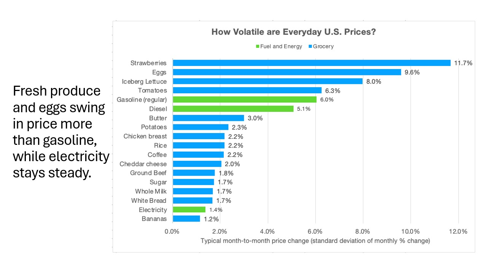
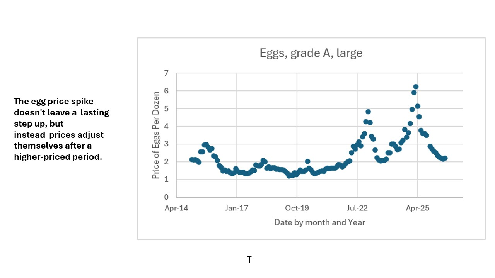
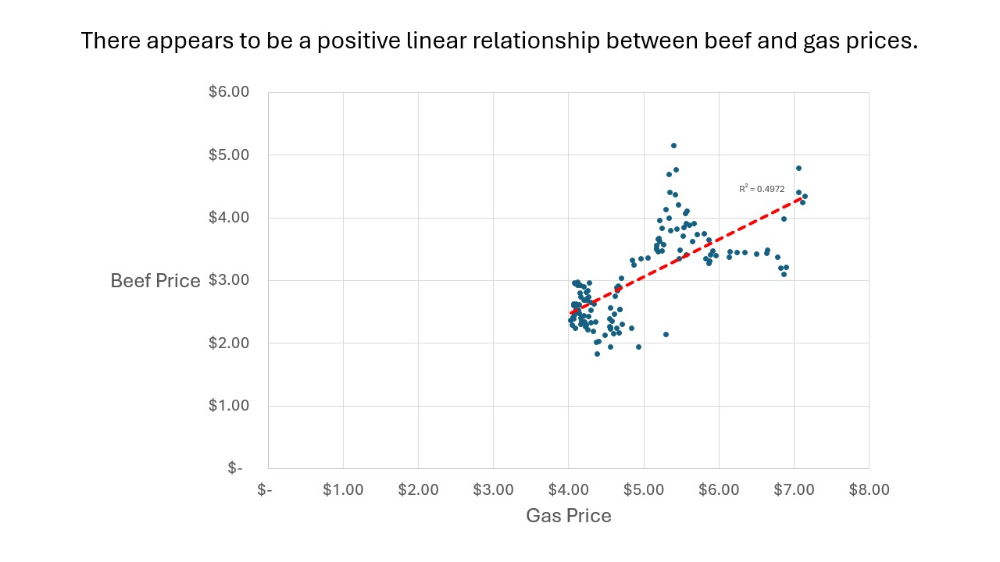
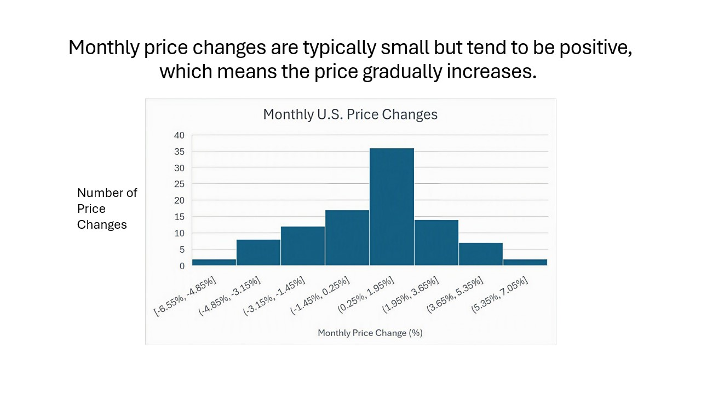

# From Pump to Pantry: Tracking U.S. Grocery and Gas Prices

## Team Members

- Molly Lingenfelter: (ePortfolio link: <https://mollylingenfelter.github.io>)

- Adam Harding: (ePortfolio link: <https://adamharding.github.io/>)

- Chase Gibbons: (ePortfolio link: <https://chaseg479.github.io/>)

- Mahala Williamson: (ePortfolio link: )

- Ryan Davis: (ePortfolio link: <https://ryandavis100.github.io>)

## Data Set

Our data set contains monthly U.S. average retail prices for 74 everyday grocery items and fuel and energy products from January 2015 through July 2026. We downloaded it from the Kaggle data set US Grocery and Gas Prices (2015-2026), and the item names and prices match the U.S. Bureau of Labor Statistics Average Price Data series. Each row represents one month, and each column holds the national average price of one item, such as a dozen grade A large eggs, a pound of ground beef, or a gallon of regular gasoline. The items include meats, dairy, produce, pantry staples, fuels, and utilities. For our bar chart, we grouped 18 of these items as either Grocery or Fuel and Energy.

To prepare the data, we pasted it into an Excel workbook, renamed the columns with clear item names and units, formatted dates and prices consistently, and copied the columns we needed into a separate analysis sheet. Some items were only tracked for part of the period or are missing a few months, so we left those cells blank instead of estimating values, and Excel skips blank cells in our calculations. All prices are nominal, meaning they are not adjusted for inflation. Questions 1 and 4 use month-to-month percent changes, which inflation barely affects over a single month. For Questions 2 and 3, the price changes we highlight are much larger than general inflation over the same period.

Link to Data Set: <https://www.kaggle.com/datasets/harshitsama/us-grocery-and-gas-prices-2015-2026>

## Problem 1

As college students on tight budgets, we notice that some prices at the grocery store and the gas pump seem to fluctuate while others barely move, so we wanted to measure which items are actually the least predictable. In Excel, we created a column of monthly percent changes for each item using the formula = (current month - previous month) / previous month, then used STDEV on each column to find the standard deviation of monthly percent change, which measures how much a price typically swings from one month to the next. We placed the results in a summary table on a separate sheet, labeled each item as Grocery or Fuel and Energy, and split the values into two columns so Excel would plot each category in its own color. We chose a horizontal bar chart so the long item names would be easy to read, sorted the bars from largest to smallest to make the ranking clear, and added data labels to show each exact value. The colors show that fresh produce and eggs are more volatile than gasoline, while electricity is one of the most stable items.

## Problem 2

Did the egg price spike leave a lasting step up? Our group found this question interesting because the price of eggs are one of the few groceries that directly correlate to both the economy and state of the country health-wise. We wanted to know how often the price of eggs, whether based on the economy or the medical state of the U.S., drastically changed, and if it did, how drastic was the change? To answer this, we calculated the average price per month of eggs per dozen through ten years to get a better idea of how drastically prices changed. We found that although there were occasionally periods of high prices and spikes of egg prices, that after a couple months, the prices returned to a normal, or average, price. The plot shows how, over time, prices spike and lower throughout the years but ultimately equal back out to an average price.

## Problem 3

Does all uncooked ground beef and all types of gas move together in price? We found this question interesting because these are two common things that people buy that seem to have gone up in price. To construct this scatter plot, we first filtered the data to show only all uncooked ground beef and all types of gas. Then, we used the beef price for the y-axis and the gas price for the x-axis to show the relationship between the two. Next, we cleaned up the graph and added the correct axis titles to improve readability. Finally, we added a linear trend line to show that beef and gas prices move together in a positive linear way, and the R2 value to represent the strength of the relationship.

## Problem 4

How volatile are everyday prices? We found this question interesting because everyday prices are always changing, but it can be hard to tell how much they actually fluctuate. We wanted to see how much prices typically change each month and whether increases or decreases are more common. To answer this question, we used Excel to calculate the monthly percentage change in prices using a formula that took the current price of a product and subtracted its previous price then divided the number by the previous price. We also used an if statement to make sure we were comparing the same products from the data set. We then created a histogram to show how often different percentage changes occurred. We adjusted the bin widths and labeled the axes to make the graph easier to read. Our results showed that most monthly price changes were relatively small but tended to be positive, suggesting that prices generally increased slightly over time.

